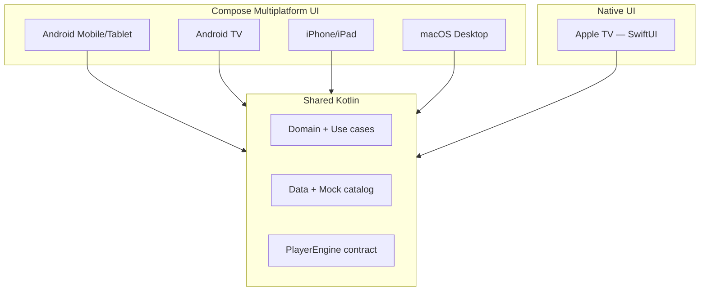

# OttPlatform — Compose Multiplatform OTT Demo

Modular, production-oriented **OTT streaming demo** built with **Kotlin Multiplatform** and **Compose Multiplatform (CMP)**.

Shared business logic and shared UI power Android (phone, tablet, TV), iOS, and macOS Desktop. **Apple TV uses SwiftUI** for UI (CMP does not officially support tvOS) while reusing Kotlin domain/data/player contracts.

## Start here — architecture docs

| Document | What you’ll learn |
|----------|-------------------|
| **[ARCHITECTURE.md](documentation/architecture/ARCHITECTURE.md)** | System overview, Clean Architecture, CMP strategy, Mermaid diagrams |
| [MODULE_STRUCTURE.md](documentation/MODULE_STRUCTURE.md) | Folders, Gradle modules, responsibilities |
| [DEPENDENCY_RULES.md](documentation/DEPENDENCY_RULES.md) | Allowed / forbidden module edges |
| [PLATFORM_SUPPORT.md](documentation/PLATFORM_SUPPORT.md) | Official support matrix & disclosures |
| [PLAYER_ARCHITECTURE.md](documentation/PLAYER_ARCHITECTURE.md) | `PlayerEngine`, Media3 / AVPlayer adapters |
| [FEATURE_EXTRACTION_GUIDE.md](documentation/FEATURE_EXTRACTION_GUIDE.md) | Enable / disable / extract features safely |
| [TESTING_GUIDE.md](documentation/TESTING_GUIDE.md) | Unit, UI, and platform test strategy |
| [BUILD_AND_RUN.md](documentation/BUILD_AND_RUN.md) | JDK, Gradle, run commands |
| [ARCHITECTURE_DECISIONS.md](documentation/ARCHITECTURE_DECISIONS.md) | ADRs and trade-offs |

## Architecture at a glance



## Design pillars

1. **Clean Architecture** — UI → domain ← data; domain stays platform-free  
2. **Feature modules** — `features/<name>/api` + `impl` for independent extraction  
3. **CMP first** — shared UI on officially supported targets  
4. **Native playback** — Media3 on Android, AVPlayer on Apple platforms  
5. **Testable by default** — fakes + `commonTest` without devices  

## Independence checks

| Check | Intent |
|-------|--------|
| Remove Search feature | Home / Player must still build |
| Replace ExoPlayer binding | Player UI unchanged |
| Run domain tests on JVM | No Android/iOS device required |

## Tech stack

- Kotlin **2.4.21** · Compose Multiplatform **1.11.1** (AGP 8.10 / compileSdk 36)
- Coroutines · Serialization · Ktor · Koin
- Media3 ExoPlayer (Android) · FakePlayerEngine (desktop/tests)
- **iptv-org** free category M3U + categories JSON

## Demo data: free IPTV API

Live catalog from **iptv-org** (no key):

- Categories: `https://iptv-org.github.io/api/categories.json`
- Shelves: `https://iptv-org.github.io/iptv/categories/{news|movies|sports|…}.m3u`

See [IPTV_DATA_SOURCE.md](documentation/IPTV_DATA_SOURCE.md).

## Run (Android OTT)

```bash
export JAVA_HOME=/usr/local/opt/openjdk@17/libexec/openjdk.jdk/Contents/Home
./gradlew :apps:androidApp:assembleDebug
./gradlew :apps:androidTvApp:assembleDebug
./gradlew :apps:desktopApp:run
```

## Unit tests (executed)

```bash
./gradlew :core:domain:desktopTest :core:data:desktopTest :core:player-api:desktopTest
```

**Passed on this machine (9 tests):** Search/Home use cases, M3U parser, watchlist repo, PlayerController.

## Status

Architecture docs + CMP foundation + IPTV-backed Home/Search/Details/Player/Watchlist demo are in progress. iOS targets temporarily omitted on this macOS x64 host (K/N host deprecated); Android + Desktop are the verified CMP paths here.

## Official references

- [Compose Multiplatform platforms](https://kotlinlang.org/docs/multiplatform/compose-compatibility-and-versioning.html)
- [KMP architecture](https://kotlinlang.org/docs/multiplatform/multiplatform-architecture.html)
- [Android TV quality](https://developer.android.com/develop/adaptive-apps/quality-guidelines/tv-app-quality)
- [tvOS HIG](https://developer.apple.com/design/human-interface-guidelines/designing-for-tvos)
