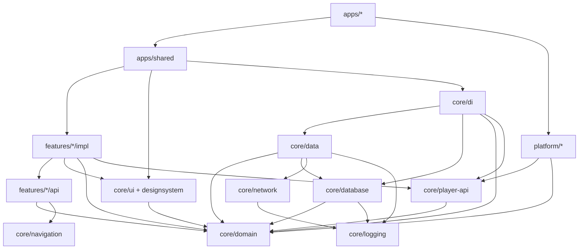

# Dependency Rules

These rules keep Clean Architecture and feature extraction practical. Violations should fail review (and ideally CI module checks).

## Golden rules

1. **Dependencies point toward domain** — never the reverse.
2. **Feature impls do not depend on other feature impls.**
3. **UI never talks to repositories directly** — only via use cases / ViewModels.
4. **Domain has zero platform or Compose imports.**
5. **Player UI depends on `PlayerEngine`, never ExoPlayer/AVPlayer.**
6. **Only app shells (`apps/*`) compose feature impl modules together.**

## Allowed dependency matrix



## Allowed / forbidden edges

| From | To | Status |
|------|----|--------|
| `features/X/impl` | `features/X/api` | Allowed |
| `features/X/impl` | `core/domain` | Allowed |
| `features/X/impl` | `core/ui`, `core/designsystem` | Allowed |
| `features/X/impl` | `core/player-api` | Allowed (player feature) |
| `features/X/impl` | `features/Y/impl` | **Forbidden** |
| `features/X/impl` | `features/Y/api` | Allowed only if X truly needs Y’s public contract |
| `features/X/api` | `features/*/impl` | **Forbidden** |
| `core/domain` | anything outside Kotlin/coroutines/datetime | **Forbidden** |
| `core/domain` | Compose / Android / iOS / Ktor | **Forbidden** |
| `core/data` | Compose UI / feature screens | **Forbidden** |
| `core/database` | Compose UI / feature screens / Ktor | **Forbidden** |
| `core/ui` | `core/data` | **Forbidden** |
| `apps/shared` | `features/*/impl` | Allowed (composition root) |
| Platform player | `core/player-api` | Allowed (implements) |
| Feature player UI | `platform/android` Media3 classes | **Forbidden** |

## Feature cross-talk pattern

When Home needs “open Search”:

- Prefer **navigation** via shared routes in `core/navigation` or `features/search/api`.
- Do **not** call Search ViewModels from Home.

When Details needs “add to Watchlist”:

- Depend on `features/watchlist/api` (port/interface), not `watchlist/impl`.
- Bind the implementation in `apps/shared` / `core/di`.

## DI registration (feature enablement)

Features are enabled by registering their Koin module in the app shell:

```kotlin
// Conceptual — composition root only
startKoin {
    modules(
        coreModule,
        dataModule,
        homeModule,      // remove this line to disable Home UI wiring
        searchModule,    // remove to disable Search
        playerModule,
        platformPlayerModule,
    )
}
```

Do not sprinkle `if (BuildConfig.FEATURE_X)` across screens. Prefer module registration + optional navigation graph contribution.

## Circular dependency policy

- No cycles between Gradle modules.
- No cycles between packages inside `domain`.
- If A-api needs B-api and B-api needs A-api, extract a neutral contract into `core/domain` or `core/navigation`.

## Quick self-check before merging

- [ ] Can `:features:search:impl` be removed from `apps/shared` without breaking `:features:home:impl`?
- [ ] Does any `commonMain` file under `core/domain` import `android.*` or `androidx.compose.*`?
- [ ] Does player UI import `androidx.media3` or `AVPlayer`?
- [ ] Do ViewModels depend on repository interfaces / use cases only?
