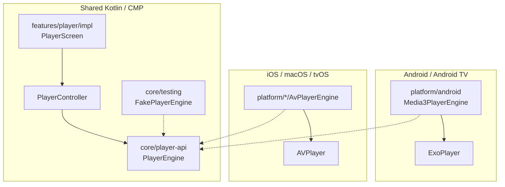
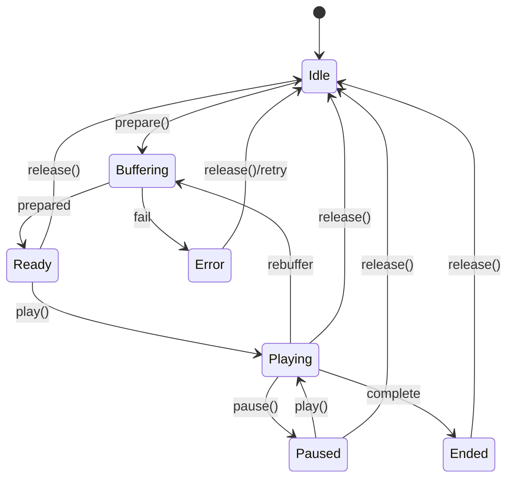

# Player Architecture

Playback is the most platform-sensitive OTT concern. Shared code owns **contracts and UX**; platforms own **decoders, DRM hooks, audio sessions, and PiP**.

## Design principles

1. Common layer never imports ExoPlayer or AVPlayer.
2. UI talks to `PlayerController` / `PlayerEngine` only.
3. DRM, codecs, background audio, and PiP stay behind platform interfaces.
4. Tests use `FakePlayerEngine` — no device required.
5. Demo media is sample / locally simulated — no production DRM license server.

## Contract

```kotlin
interface PlayerEngine {
    val playerState: StateFlow<PlayerState>

    fun prepare(media: MediaItem)
    fun play()
    fun pause()
    fun seekTo(positionMs: Long)
    fun selectSubtitle(trackId: String?)
    fun selectAudioTrack(trackId: String)
    fun selectVideoQuality(quality: VideoQuality)
    fun release()
}
```

Supporting models (conceptual):

- `PlayerState` — idle / buffering / ready / playing / paused / ended / error
- `PlaybackPosition` — current / duration / buffered
- `MediaItem` — id, url/stream uri, title, subtitle/audio catalogs (demo)
- `SubtitleTrack`, `AudioTrack`, `VideoQuality`
- `PlaybackError` — typed, UI-mappable

## Component diagram



## Responsibilities

| Component | Owns |
|-----------|------|
| `PlayerScreen` (CMP) | Controls chrome, menus, seek bar, focus on TV |
| `PlayerController` | Maps UI intents → engine; exposes UI state |
| `PlayerEngine` | Playback lifecycle on a device |
| Platform modules | Engine construction, surface/view binding, DRM stubs |
| `FakePlayerEngine` | Deterministic state for unit tests |

## Platform mapping

| Platform | Engine | UI |
|----------|--------|----|
| Android Mobile / Tablet | Media3 ExoPlayer | Shared CMP player UI |
| Android TV | Media3 ExoPlayer | Shared CMP + TV focus controls |
| iOS | AVPlayer | Shared CMP player UI |
| macOS Desktop | AVPlayer / desktop adapter | Shared CMP player UI |
| Apple TV | AVPlayer | **Native SwiftUI** player chrome |

## Lifecycle



## What stays out of common code

- ExoPlayer `MediaItem` / `Player.Listener`
- AVPlayer / AVPlayerViewController / AVKit
- Widevine / FairPlay license exchange
- Audio focus / Now Playing / PiP APIs
- Decoder capability queries

These may be modeled as optional ports later (`DrmSessionFactory`, `AudioSessionController`) without leaking SDKs into domain.

## Test strategy

| Test | Approach |
|------|----------|
| Controller unit test | Inject `FakePlayerEngine` |
| Contract test | Assert state transitions on fake |
| Android instrumentation | Optional Media3 smoke (device/emulator) |
| iOS/tvOS UI | XCUITest against native chrome when Xcode available |

See [TESTING_GUIDE.md](TESTING_GUIDE.md).
