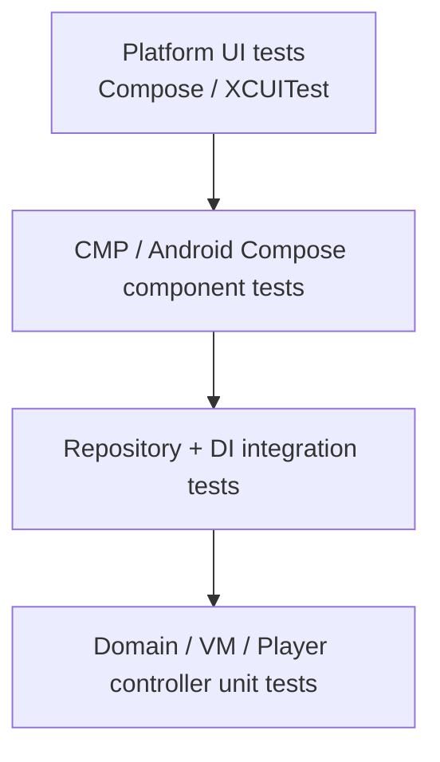
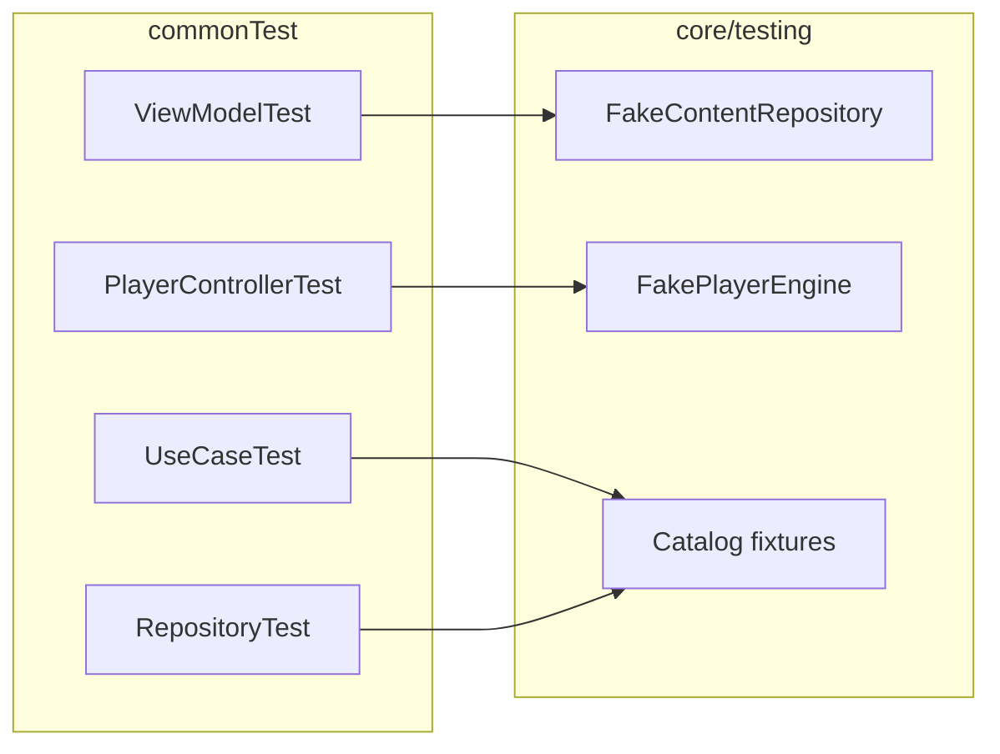

# Testing Guide

Testing is part of the architecture, not a follow-up. Shared business logic must be testable on the JVM without launching Android or iOS.

## Test pyramid



## What to test where

| Layer | Tooling | Runs on |
|-------|---------|---------|
| Use cases / domain validation | `kotlin.test` + coroutines-test | `commonTest` (JVM) |
| Repository + mappers | `kotlin.test`, fakes | `commonTest` |
| ViewModels / state transitions | coroutines-test, Turbine optional | `commonTest` |
| Player controller | `FakePlayerEngine` | `commonTest` |
| Design system / cards | CMP UI tests where available | JVM / Android |
| Android screens | Compose UI Test | Android instrumented |
| Android TV focus | Compose + Espresso / UI Automator | Android TV emulator |
| iOS / macOS UI | XCTest / XCUITest | Mac + Xcode |
| tvOS UI | XCUITest | Mac + Xcode + tvOS simulator |

## Mandatory example coverage

The repo should include sample tests for at least:

1. A **domain use case**
2. A **ViewModel** state transition
3. A **repository** (mock catalog)
4. A **reusable Compose component** (e.g. content card)
5. A **player controller** with `FakePlayerEngine`

## Conventions

- Prefer **fakes** over heavy mocking frameworks in common code.
- Use **deterministic dispatchers** (`StandardTestDispatcher`).
- Mark Compose nodes with **test tags** / semantics for stable selectors.
- Do **not** claim a test passed unless it was executed in this environment.
- Document skipped targets (e.g. no Xcode) as **unverified**.

## Commands (typical)

```bash
# Shared unit tests (JVM)
./gradlew :core:domain:cleanAllTests :core:domain:allTests
./gradlew :core:data:allTests
./gradlew :features:home:impl:desktopTest

# Android unit / connected (when emulator available)
./gradlew :apps:androidApp:testDebugUnitTest
./gradlew :apps:androidApp:connectedDebugAndroidTest

# Desktop
./gradlew :apps:desktopApp:test
```

### Executed on this machine (2026-11-16)

```bash
./gradlew testDebugUnitTest desktopTest --console=plain
```

**Total:** 15 suites, **26 tests passed** (0 failures, 0 errors, 0 skipped):

| Suite | Target(s) | Tests | Result |
|-------|-----------|-------|--------|
| `SqlDelightDataSourcesTest` | `desktopTest` | 2 | Passed |
| `IptvCatalogRepositoryOfflineTest` | `desktopTest`, `testDebugUnitTest` | 1 × 2 | Passed |
| `M3uPlaylistParserTest` | `desktopTest`, `testDebugUnitTest` | 3 × 2 | Passed |
| `InMemoryWatchlistRepositoryTest` | `desktopTest`, `testDebugUnitTest` | 1 × 2 | Passed |
| `SearchChannelsUseCaseTest` | `desktopTest`, `testDebugUnitTest` | 2 × 2 | Passed |
| `GetHomeFeedUseCaseTest` | `desktopTest`, `testDebugUnitTest` | 2 × 2 | Passed |
| `PlayerControllerTest` | `desktopTest`, `testDebugUnitTest` | 2 × 2 | Passed |
| `HomeViewModelTest` | `desktopTest`, `testDebugUnitTest` | 1 × 2 | Passed |

Also verified on physical devices & Web (`2026-11-16` / `2026-11-17`):
- **iPhone 13 (`com.ott.platform.ios`)**: Built, installed, and launched via Xcode/devicectl; verified `ott_platform.db` cached 29 categories and 320 channels.
- **Samsung Android Phone (`SM-A076B`, `com.ott.platform.android`)**: Installed via `:apps:androidApp:installDebug` and launched; verified `ott_platform.db` cached 29 categories and 320 channels.
- **Samsung Galaxy Tab (`SM_P613`, `com.ott.platform.android`)**: Installed via `:apps:androidApp:installDebug` and launched; verified `ott_platform.db` cached 29 categories and 320 channels.
- **Smart TV (`192.168.1.24:5555`, `com.ott.platform.androidtv`)**: Installed via `:apps:androidTvApp:assembleDebug` and launched `TvMainActivity`.
- **Web (`wasmJs`, `apps/webApp`)**: Built production Wasm bundle (`:apps:webApp:wasmJsBrowserDistribution`), served on `http://localhost:8080/`, and verified Home UI + Coil images + `localStorage` offline caching (`ott_web_categories_v1`, `ott_web_shelves_v1`) in browser.

## Test architecture diagram



## Platform UI strategy notes

### Compose Multiplatform

- Put reusable component tests next to `core/ui` / `core/designsystem` when tooling supports the target.
- Keep screens injectable (ViewModel via DI) so UI tests can supply fakes.

### Android TV

- Assert focus moves across shelf rows with D-pad key events.
- Assert focused card has a visible focus indicator.

### Apple platforms

- iOS/macOS: XCUITest against accessibility identifiers mirrored from Compose semantics where possible.
- tvOS: XCUITest against SwiftUI identifiers; shared logic still covered by commonTest.
